# Step 5 OLAP Application Test Cases

## Before testing

1. Start MySQL and confirm the `nyc_taxi_dw` warehouse is populated.
2. Start the dashboard with `streamlit run app.py`.
3. In MySQL Workbench, open and execute `mysqlworkbench_validation.sql`.
4. Leave the SQL result grids open. Each result set has a `test_case` label.

The default test slice is:

- Pickup date from: `2024-06-01`
- Pickup date to: `2024-06-30`
- Pickup borough: `All boroughs`
- Payment category: `All payment categories`

Always click **Apply filters** after changing a global filter.

## Test cases

| ID | Dashboard actions | MySQL result set | Expected comparison |
|---|---|---|---|
| T01 | Apply the default test slice. Record the four KPI cards. | `T01 - KPI baseline` | Trips, revenue, average distance, and tips should match, allowing for dashboard currency/decimal formatting. |
| T02 | Set Pickup borough to Bronx. Keep payment as All. Apply filters. | `T02 - Borough slice` | Dashboard KPI values should equal the T02 row. Trip count must not exceed T01. |
| T03 | Set the T02 borough and the payment category shown in the T03 header. Apply filters. | `T03 - Borough and payment dice` | Dashboard KPI values should equal the T03 row and normally be no greater than the T02 slice. |
| T04 | In Revenue trends, select Day and month. | `T04A`–`T04B` | Each dashboard table must match its corresponding period, counts, revenue, tips, and average fare. Month/quarter/year are roll-ups of finer levels. |
| T05 | In Location analysis, select Borough then Zone. Repeat with Pickup and Drop-off. | `T05A`–`T05C` | Dashboard rows and measures should match. The Drop-off report is still filtered by pickup date and pickup borough, as documented in the UI code. |
| T06 | In Time demand, select Day period and then Hour of day. | `T06A`–`T06B` | Dashboard buckets, trip counts, revenue, and average duration should match. |
| T07 | In Pivot analysis, select Pivot rows = Pickup borough and Pivot measure = Revenue. | `T07` | Each dashboard row/column cell should match `measure_value` for the same borough and payment category. |

## Correctness checks

For each dashboard report, compare:

- Row labels and bucket names
- Number of rows
- Trip counts
- Revenue totals
- Tip totals
- Average values
- Sort order

Small display differences are expected because the dashboard formats values:

- Revenue and tips are shown as currency with two decimals.
- Average distance is shown with two decimals.
- The location report displays only the top 25 SQL rows and charts the first 15.

The dashboard's location filter is a **pickup-borough** filter even when the
location role is changed to Drop-off. This is intentional and should be stated
when documenting T05.

## Test result record

| Test ID | Dashboard result | MySQL result | Match?||
|---|---|---|---|---|
| T01 |Trips: 3,464,354 Total Revenue: $98,209,110.94   | 3464354, 98209110.94 |  PASS |  |
| T02 | 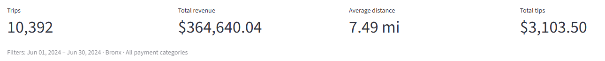 | 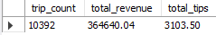 | PASS |  |
| T03 | 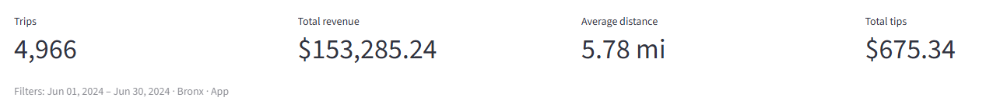 |  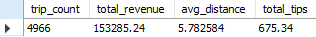|  PASS |  |
| T04A | *First 5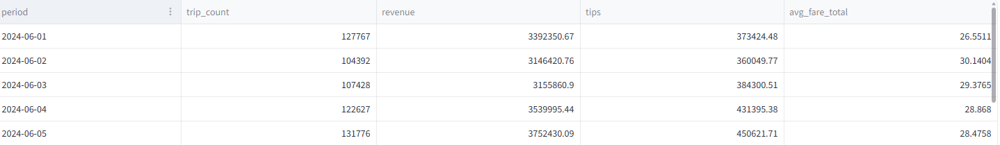 | *First 5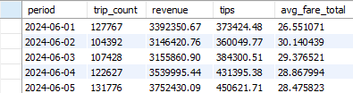 |PASS  |  |
| T04B | 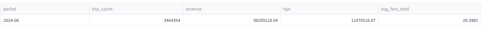 | 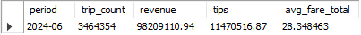 |  PASS|  |
| T05A | 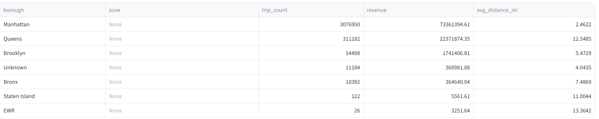 | 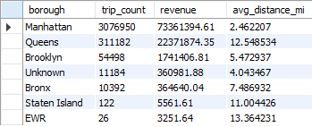 | PASS |  |
| T05B | *First 5 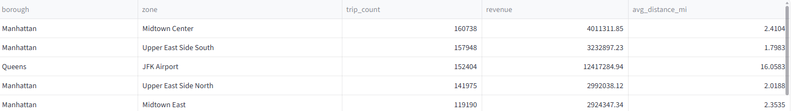 |*First 5 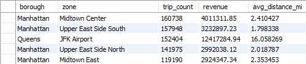 | PASS |  |
| T05C |  *First 5 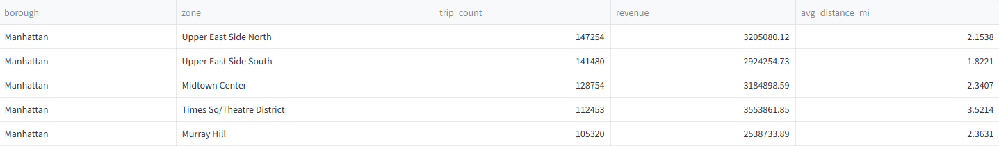| *First 5 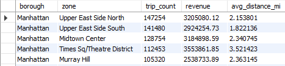| PASS |  |
| T06A | 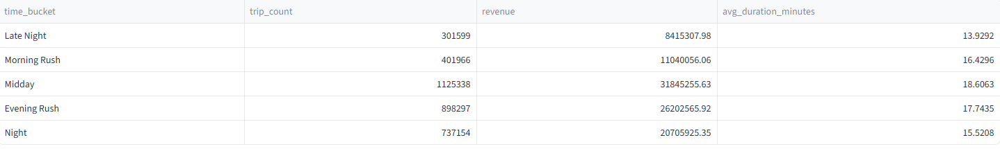 | 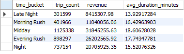 | PASS |  |
| T06B | *First 5 hours 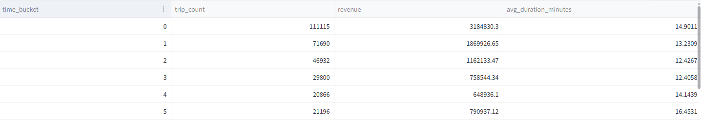 | *First 5 hours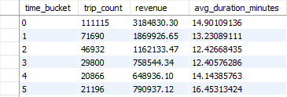 | PASS |  |
| T07 | *For Bronx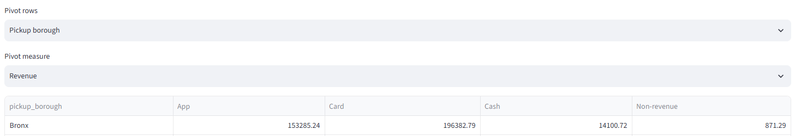 | *For Bronx 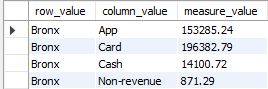 | PASS |  |

